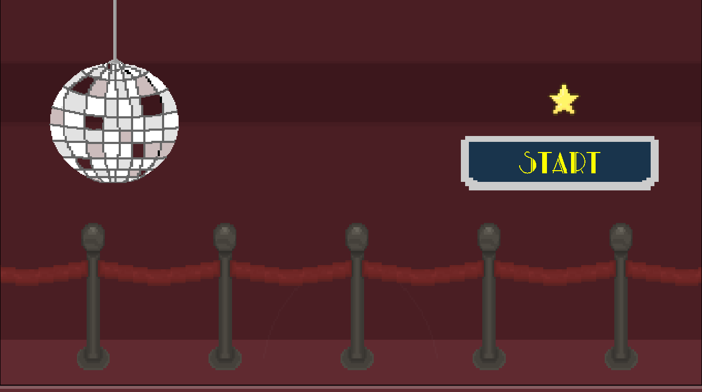
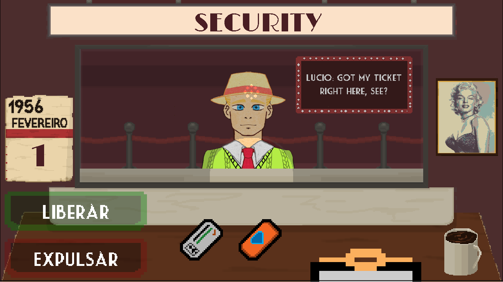
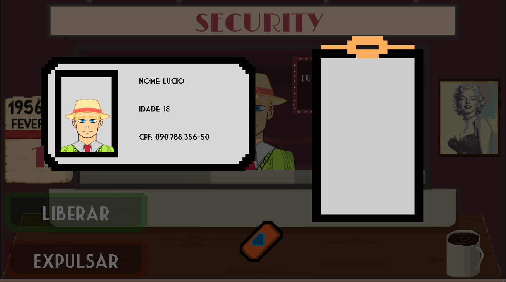
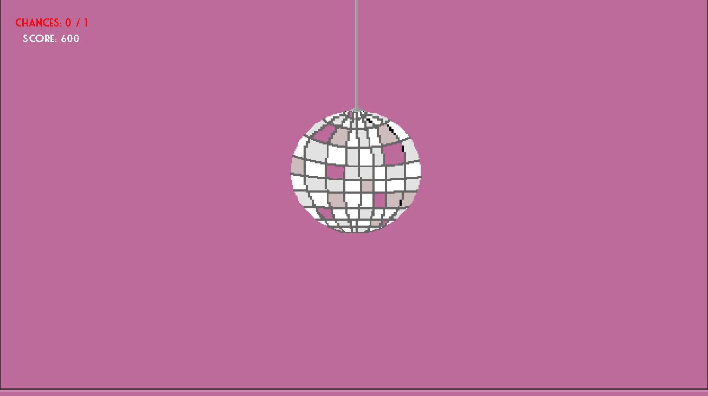
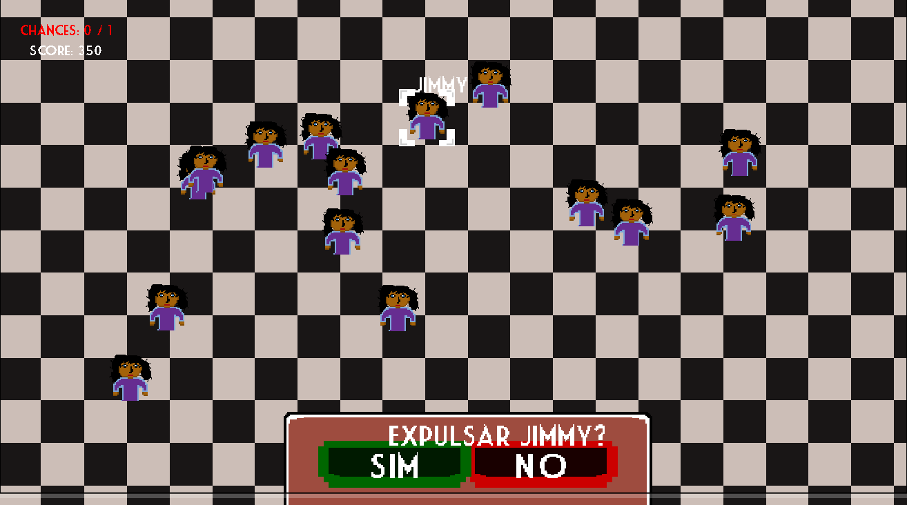
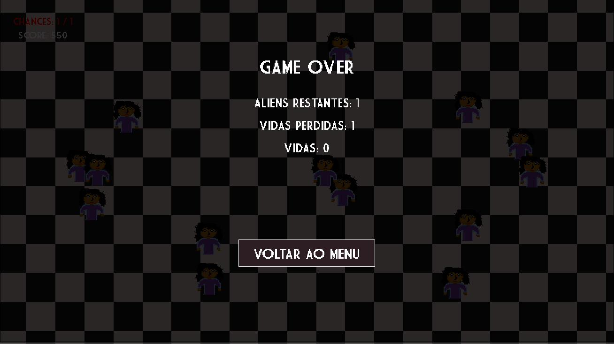

# 🛸 Aliens Gamejam

  <!-- Adicione a logo do jogo futuramente -->

<h1 align="center">👽 Aliens Gamejam</h1>

  Um jogo de gerenciamento e investigação no qual você precisa identificar visitantes alienígenas, controlar a entrada de pessoas e impedir que ameaças invadam uma balada.

---

## 📖 Sobre o Projeto

**Aliens Gamejam** é um jogo desenvolvido utilizando GameMaker, no qual o jogador assume o papel de responsável pelo controle de entrada de uma balada em um cenário onde alienígenas estão tentando se infiltrar entre os humanos.

Durante cada dia, diferentes visitantes aparecem para serem interrogados. Por meio de conversas e informações apresentadas durante a inspeção, o jogador precisa decidir se deve liberar ou expulsar cada pessoa.

Entretanto, nem todas as decisões são simples: liberar um alienígena permite que ele entre na balada, enquanto expulsar uma pessoa inocente gera penalidades.

Ao final do expediente, os alienígenas que conseguiram entrar precisam ser identificados e expulsos antes que escapem. Cada ameaça não neutralizada representa a perda de uma vida.

O objetivo é sobreviver ao maior número possível de dias, tomar decisões corretas e impedir uma invasão alienígena.

---

## 📑 Índice

- [Sobre o Projeto](#-sobre-o-projeto)
- [Tecnologias Utilizadas](#-tecnologias-utilizadas)
- [Como Jogar](#-como-jogar)
- [Screenshots](#-screenshots)
- [Equipe](#-equipe-do-projeto)
- [Game Jam](#-game-jam)
- [Licença](#-licença)

---

## 🧰 Tecnologias Utilizadas

### Desenvolvimento

- **GameMaker**
- **GameMaker Language (GML)**

### Ferramentas

- **GameMaker IDE**
- **Git**
- **GitHub**
- **Krita**
- **Libresprite**

---

## ☕ Como Jogar

### 👥 Inspeção de visitantes

A cada dia, um grupo de visitantes aparece na cabine de inspeção. Observe os personagens e acompanhe seus diálogos para identificar possíveis alienígenas infiltrados.

### ✅ Liberar ou expulsar

Após a conversa, escolha entre duas ações:

- **Liberar:** permite que o visitante entre na balada.
- **Expulsar:** impede a entrada do visitante.

Cada decisão influencia sua pontuação e o andamento da partida. Liberar um alienígena ou expulsar um humano gera penalidades.

### 🪩 Controle da balada

Quando alienígenas conseguem entrar, o jogador precisa identificá-los e expulsá-los antes que escapem.

### ❤️ Sistema de vidas

Os alienígenas que não forem neutralizados representam vidas perdidas. Se todas as vidas acabarem, a partida termina.

### 📅 Progressão

Sobreviva aos dias, administre suas decisões e tente manter a balada livre de alienígenas pelo maior tempo possível.

---

## 📸 Screenshots

---
## 👨‍💻 Equipe do Projeto

<table>
<tr>
<td align="center" width="20%">
<a href="https://github.com/pegeOS">
 
<strong>Pedro Gabriel</strong>
</a>
</td>
<td align="center" width="20%">
<a href="https://github.com/AngeloMatos08">
 
<strong>Ângelo Matos</strong>
</a>
</td>
<td align="center" width="20%">
<a href="https://github.com/torilocode">
 
<strong>Henk Narciso</strong>
</a>
</td>
<td align="center" width="20%">
 
<strong>Julio</strong>
</td>
<td align="center" width="20%">
 
<strong>Isabella</strong>
</td>
</tr>
<tr>
<td align="center" valign="top">
 
🎮 <strong>Game Design e Game Dev</strong>
  
Concepção e desenvolvimento das principais mecânicas do jogo.
</td>
<td align="center" valign="top">
 
💻 <strong>Game Dev</strong>
  
Implementação dos sistemas, mecânicas e lógica do jogo.
</td>
<td align="center" valign="top">
 
♫ <strong>Game Design e Sound Design</strong>
  
Desenvolvimento de fases e produção da trilha sonora.
</td>
<td align="center" valign="top">
 
🎨 <strong>Art & Creative Design</strong>
  
Criação das artes e referências visuais da época retratada.
</td>
<td align="center" valign="top">
 
🎨 <strong>Art & Creative Design</strong>
  
Criação das artes e referências visuais da época retratada.
</td>
</tr>
</table>

---

## 🎮 Game Jam

O **Aliens Gamejam** foi desenvolvido para a [THE HENSJAM](https://itch.io/jam/hensjam), uma Game Jam que propõe aos participantes o desafio de criar um jogo dentro de um período determinado.

A participação proporcionou a oportunidade de desenvolver um projeto do zero, explorar mecânicas de gameplay e aplicar conceitos de programação e desenvolvimento de jogos.

---

## 🎮 Jogue

  <strong>Em breve no itch.io!</strong>

<!-- Após publicar, substitua o texto acima pelo link da página do jogo -->

---

## 🎯 Objetivo do Projeto

Durante o desenvolvimento, foram trabalhados conceitos como:

- Lógica de programação e estruturas condicionais.
- Organização e manipulação de dados.
- Programação orientada a objetos por meio de estruturas e construtores.
- Gerenciamento de estados e eventos.
- Criação e controle de instâncias.
- Transições entre salas e sequências.
- Sistemas de pontuação, progressão e condições de vitória e derrota.
- Desenvolvimento de interfaces e interação com o jogador.

---

## 📄 Licença

Projeto desenvolvido com finalidade educacional e de participação em Game Jam.

Consulte as condições de uso e distribuição antes de reutilizar ou redistribuir os arquivos do projeto.

---

  Desenvolvido com 👽 utilizando GameMaker e GameMaker Language.

