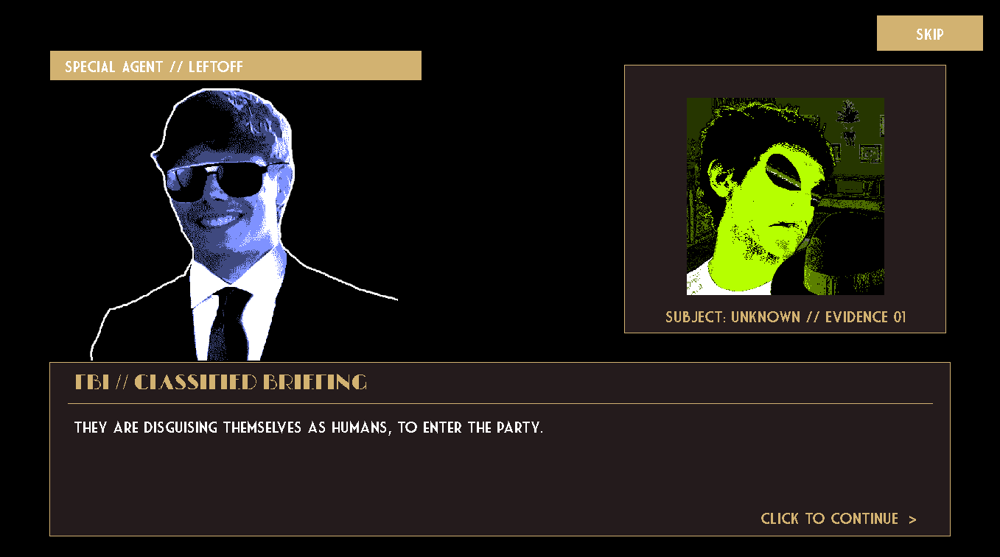
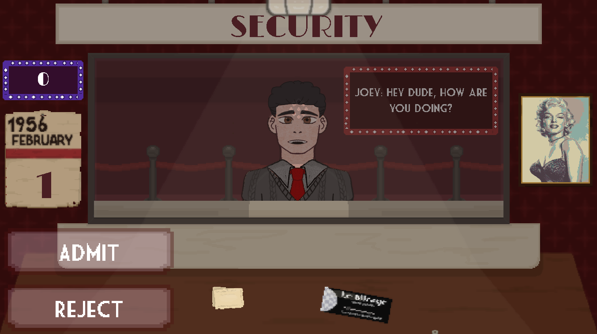
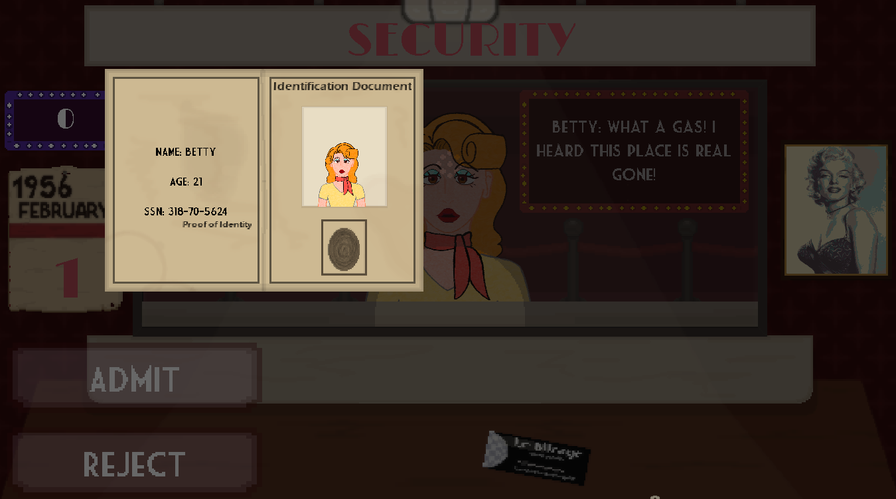
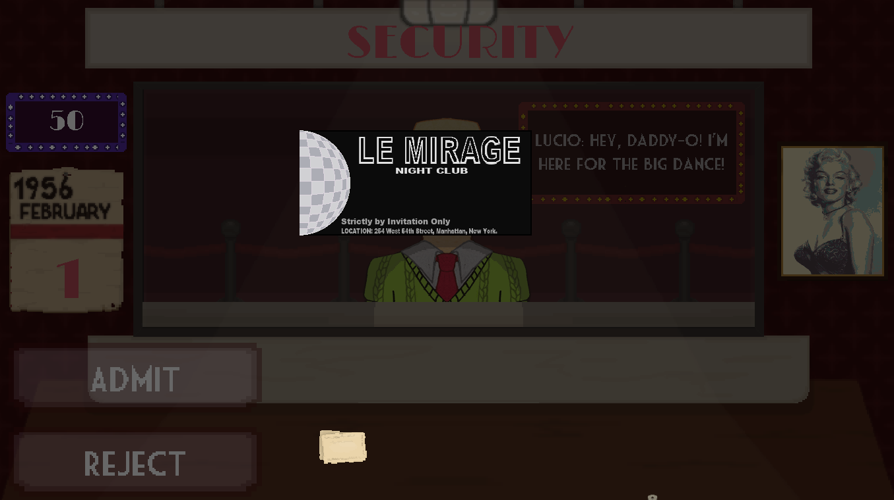
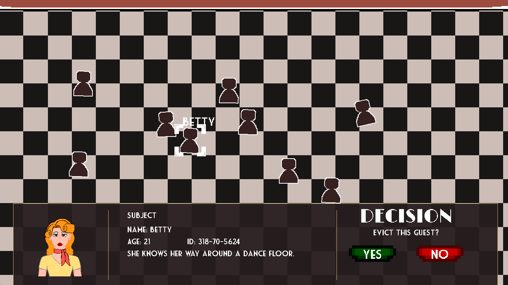
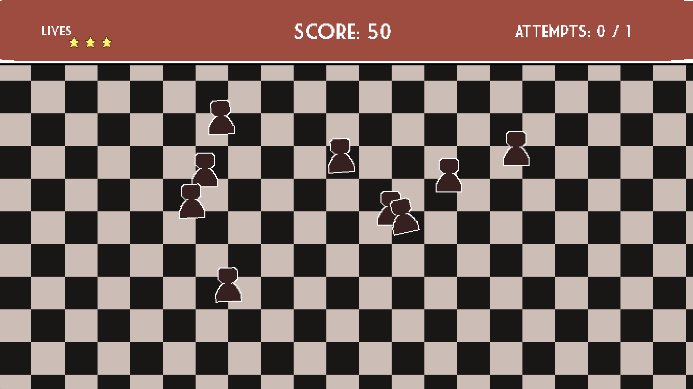
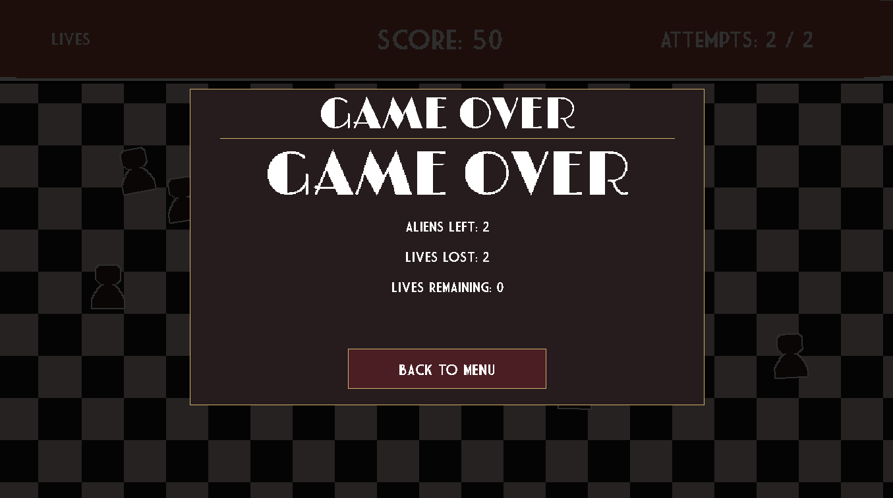
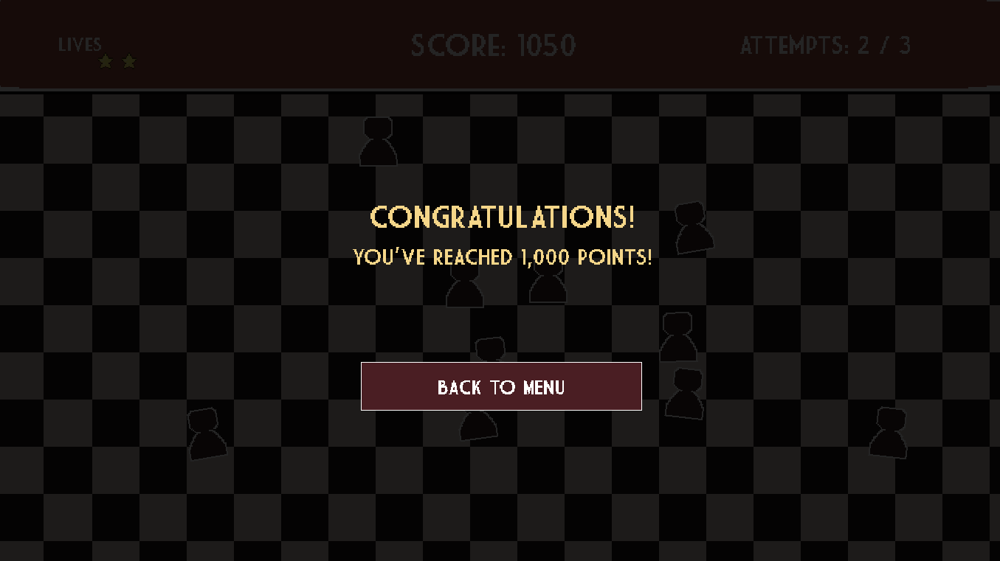

# 🛸 Aliens Gamejam

<h1 align="center">👽 Aliens Gamejam</h1>

  Um jogo de investigação e gerenciamento de entrada ambientado em uma balada dos anos 1950. Identifique os alienígenas disfarçados de humanos antes que eles invadam a festa.

---

## 📖 Sobre o Projeto

**Aliens Gamejam** é desenvolvido em GameMaker. O jogador trabalha na segurança de uma balada em 1956 e precisa descobrir quais visitantes são alienígenas disfarçados.

Antes da primeira partida, o agente especial Leftoff apresenta a ameaça em uma introdução cinematográfica. Em cada dia, visitantes aparecem para conversar e apresentar seus documentos. O jogador analisa as pistas e decide quem pode entrar.

Os alienígenas que entram precisam ser identificados e expulsos na pista de dança. A pontuação, os erros e as vidas determinam a progressão da partida.

O objetivo é manter a festa segura, sobreviver aos dias e alcançar 1.000 pontos.

---

## 📑 Índice

- [Sobre o Projeto](#-sobre-o-projeto)
- [Tecnologias Utilizadas](#-tecnologias-utilizadas)
- [Como Jogar](#-como-jogar)
- [Atualizações](#-atualizações)
- [Screenshots](#-screenshots)
- [Equipe](#-equipe-do-projeto)
- [Game Jam](#-game-jam)
- [Licença](#-licença)

---

## 🧰 Tecnologias Utilizadas

### Desenvolvimento

- **GameMaker**
- **GameMaker Language (GML)**

### Ferramentas

- **GameMaker IDE**
- **Git**
- **GitHub**
- **Krita**
- **Libresprite**

---

## ☕ Como Jogar

### Introdução

O agente Leftoff explica a ameaça antes da primeira partida. As falas são apresentadas gradualmente; clique ou toque para completar uma fala e avançar. A introdução também pode ser pulada.

### Cabine de segurança

Observe cada visitante, leia o diálogo e clique nos documentos para examiná-los. Depois, escolha:

- **Admit:** deixa o visitante entrar na festa.
- **Reject:** impede a entrada.

O documento ampliado mostra o retrato, o nome, a idade e o SSN do visitante. Use as conversas e os dados para distinguir alienígenas de humanos.

### Balada

Se alienígenas entrarem, selecione os suspeitos na pista e expulse-os. Cada alienígena que permanecer na festa pode custar uma vida.

### Pontuação e progressão

- Decisões corretas aumentam a pontuação; decisões incorretas podem reduzi-la.
- Expulsar um humano sem convite é uma decisão correta e rende pontos.
- Se nenhum alienígena entrar, o jogador pode avançar diretamente para o próximo dia.
- Se aliens entrarem, é preciso lidar com eles na balada antes de continuar.
- A partida termina se as vidas acabarem. Alcançar 1.000 pontos conclui a campanha com vitória.

Os visitantes são selecionados pelo sistema de distribuição diária. Alguns aparecem a partir de um dia específico e podem voltar a ser sorteados nos dias seguintes, sem serem obrigatórios todos os dias.

Os controles de clique também aceitam toque em dispositivos Android.

---

## 🛠️ Atualizações

- Corrigido o espaçamento das descrições de visitantes para permitir uma ou duas linhas dentro do painel.
- Corrigida a disponibilidade de visitantes com dia de estreia, para que continuem elegíveis em dias posteriores.
- Ajustado o mapeamento de sprites de reação dos NPCs.
- Corrigida a pontuação para expulsar humanos sem convite.
- Adicionada a introdução do agente Leftoff, com diálogo gradual, avanço por clique/toque e opção de pular.
- Organizados o ID ampliado, o retrato e os dados de identificação; aumentada a legibilidade do documento.
- Padronizados os SSNs fictícios no formato visual `###-##-####`, mantendo um número repetido como pista alienígena da Marta.
- Desativada a prancheta da cabine e reposicionados os documentos sobre a mesa.
- Atualizadas as telas de resultado do turno, da balada, de game over e de vitória, mantendo o fluxo entre as etapas.
- Corrigida a sobreposição do relatório do turno sobre a tela de vitória.

---

## 📸 Screenshots

<figure>
  
  <figcaption>O agente especial Leftoff apresenta a ameaça alienígena.</figcaption>
</figure>

<figure>
  
  <figcaption>Inspeção de visitantes na cabine de segurança.</figcaption>
</figure>

<figure>
  
  <figcaption>Documento ampliado com retrato e informações de identificação.</figcaption>
</figure>

<figure>
  
  <figcaption>Convite e decisões de entrada.</figcaption>
</figure>

<figure>
  
  <figcaption>Identificação de suspeitos na pista de dança.</figcaption>
</figure>

<figure>
  
  <figcaption>A balada e seus visitantes.</figcaption>
</figure>

<figure>
  
  <figcaption>Relatório de game over.</figcaption>
</figure>

<figure>
  
  <figcaption>Vitória ao alcançar 1.000 pontos.</figcaption>
</figure>

---
## 👨‍💻 Equipe do Projeto

<table>
<tr>
<td align="center" width="20%">
<a href="https://github.com/pegeOS">
 
<strong>Pedro Gabriel</strong>
</a>
</td>
<td align="center" width="20%">
<a href="https://github.com/AngeloMatos08">
 
<strong>Ângelo Matos</strong>
</a>
</td>
<td align="center" width="20%">
<a href="https://github.com/torilocode">
 
<strong>Henk Narciso</strong>
</a>
</td>
<td align="center" width="20%">
<a href="https://github.com/GDevXyslet">
 
<strong>Julio</strong>
</td>
<td align="center" width="20%">
 
<strong>Isabella</strong>
</td>
</tr>
<tr>
<td align="center" valign="top">
 
🎮 <strong>Game Design e Game Dev</strong>
  
Concepção e desenvolvimento das principais mecânicas do jogo.
</td>
<td align="center" valign="top">
 
💻 <strong>Game Dev</strong>
  
Implementação dos sistemas, mecânicas e lógica do jogo.
</td>
<td align="center" valign="top">
 
♫ <strong>Game Design e Sound Design</strong>
  
Desenvolvimento de fases e produção da trilha sonora.
</td>
<td align="center" valign="top">
 
🎨 <strong>Art & Creative Design</strong>
  
Criação das artes e referências visuais da época retratada.
</td>
<td align="center" valign="top">
 
🎨 <strong>Art & Creative Design</strong>
  
Criação das artes e referências visuais da época retratada.
</td>
</tr>
</table>

---

## 🎮 Game Jam

O **Aliens Gamejam** foi desenvolvido para a [THE HENSJAM](https://itch.io/jam/hensjam), uma Game Jam que propõe aos participantes o desafio de criar um jogo dentro de um período determinado.

A participação proporcionou a oportunidade de desenvolver um projeto do zero, explorar mecânicas de gameplay e aplicar conceitos de programação e desenvolvimento de jogos.

---

## 🎮 Jogue

  <strong>Em breve no itch.io!</strong>

<!-- Após publicar, substitua o texto acima pelo link da página do jogo -->

---

## 🎯 Objetivo do Projeto

Durante o desenvolvimento, foram trabalhados conceitos como:

- Lógica de programação e estruturas condicionais.
- Organização e manipulação de dados.
- Programação orientada a objetos por meio de estruturas e construtores.
- Gerenciamento de estados e eventos.
- Criação e controle de instâncias.
- Transições entre salas e sequências.
- Sistemas de pontuação, progressão e condições de vitória e derrota.
- Desenvolvimento de interfaces e interação com o jogador.

---

## 📄 Licença

Projeto desenvolvido com finalidade educacional e de participação em Game Jam.

Consulte as condições de uso e distribuição antes de reutilizar ou redistribuir os arquivos do projeto.

---

  Desenvolvido com 👽 utilizando GameMaker e GameMaker Language.

